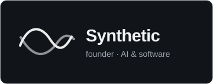

<!-- A small corner of the internet. -->

  

<h1 align="center">hey, i'm omar.</h1>

  student · self-taught developer · curious about a little too much

  &nbsp;&nbsp;&nbsp;&nbsp;
  &nbsp;&nbsp;&nbsp;&nbsp;
  &nbsp;&nbsp;&nbsp;&nbsp;
  

 

### a little about me

I'm Omar, a student and software developer based in the UAE. I like figuring out how things work, experimenting with ideas, and building things from scratch — especially around **AI, software, and design**.

A lot of my learning happens by actually making things. I tend to get curious about something, go down a rabbit hole, and come out with more questions than I started with.

Outside of coding, I'm into **entrepreneurship, research, financial markets, and football**. There's a lot I still want to understand.

 

### where i'm involved

<table>
  <tr>
    <td width="50%"></td>
    <td width="50%"></td>
  </tr>
</table>

I'm building **Synthetic** around a long-term interest in AI, software, and privacy-first technology. I'm also part of **The Knowledge Society (TKS)** through **Innovate 2026–27** and **Velocity** — exploring emerging technologies and learning alongside other builders.

 

### things i build with

  &nbsp;&nbsp;
  &nbsp;&nbsp;
  &nbsp;&nbsp;
  &nbsp;&nbsp;
  &nbsp;&nbsp;
  &nbsp;&nbsp;
  &nbsp;&nbsp;
  &nbsp;&nbsp;
  &nbsp;&nbsp;
  

Not an exhaustive list. Just some tools I keep coming back to.

  

---

still learning, still figuring things out.

