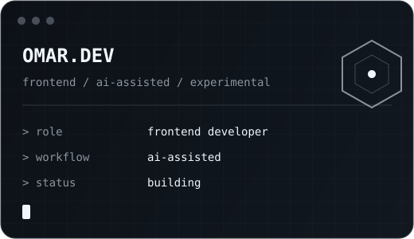

# OMAR

**web interfaces · desktop tools · experimental software**

<table>
<tr>
<td width="58%" valign="top">

### What I do

I build interactive web experiences, desktop apps, and tools that make everyday workflows feel better.

Most of my work starts as a rough idea, gets prototyped fast, then gets rebuilt and polished until it feels intentional.

I use AI as part of the workflow — not as the whole workflow.

### How I work

`idea → prototype → break it → rebuild it → polish it`

</td>
<td width="42%" align="center">

</td>
</tr>
</table>

## Stack

  
  
  
  
  
  
  
  

## Selected work

<table>
<tr>
<td width="50%" valign="top">

### BLACKBOX Terminal

A custom Electron command terminal for launching apps, opening projects, navigating folders, and starting full workspaces from one place.

</td>
<td width="50%" valign="top">

### BLACKBOX

A cinematic browser terminal with boot sequences, custom commands, system panels, logs, and interactive visual effects.

</td>
</tr>
<tr>
<td width="50%" valign="top">

### JARVIS

A desktop assistant experiment with app launching, voice lines, project detection, and cinematic system overlays.

</td>
<td width="50%" valign="top">

### OMAR_SYS

An interactive system-style web experience with custom windows, built-in apps, desktop behavior, and a darker visual identity.

</td>
</tr>
</table>

## Learning now

`Python` &nbsp; `APIs` &nbsp; `Automation` &nbsp; `Software architecture`

---

building, testing, rebuilding.
