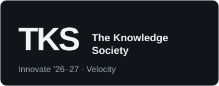
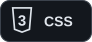
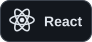
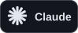

<!-- A small corner of the internet. -->

  

<h1 align="center">hey, i'm omar.</h1>

student · software developer · curious about more than code

  &nbsp;&nbsp;
  &nbsp;&nbsp;
  &nbsp;&nbsp;
  

 

### a little about me

I'm Omar, a student and software developer based in the UAE. I'm interested in **AI, building software, and design** — but I spend just as much time trying to understand how other things work.

I like experimenting with ideas, making things from scratch, and figuring things out as I go. One rabbit hole usually leads to another.

Outside of code, I'm interested in **entrepreneurship, emerging technology, financial markets, and football**. There are still a lot of things I want to learn.

 

### where i'm involved

<table>
  <tr>
    <td width="50%" valign="middle"></td>
    <td width="50%" valign="middle"></td>
  </tr>
</table>

I'm building **Synthetic** around a long-term interest in AI, software, and privacy-first technology. I'm also part of **The Knowledge Society (TKS)** — **Innovate 2026–27** and **Velocity** — where I explore emerging technology and learn alongside other builders.

 

### what i've been exploring

- **AI & agents** — experimenting with intelligent software and how multiple systems work together.
- **Web & interfaces** — learning how to make software useful, understandable, and well-designed.
- **Privacy & infrastructure** — thinking more deeply about how technology handles trust and data.
- **Startups & markets** — trying to understand how products, businesses, and the wider world work.

 

### tools & technologies

Kept to things I actually use or have built with — not a list of everything I've ever heard of.

<strong>web development</strong>

  &nbsp;
  &nbsp;
  &nbsp;
  &nbsp;
  &nbsp;
  &nbsp;

<strong>workspace & AI</strong>

  &nbsp;
  &nbsp;
  &nbsp;
  &nbsp;
  &nbsp;

 

### activity

  

Automatically refreshed daily from GitHub’s contribution calendar using GitHub Actions. Private activity is counted only when GitHub makes its anonymized totals available; private repository details remain hidden. <a href="https://github.com/omar-azim13">See GitHub’s native calendar</a> for the canonical count.

  

---

still learning. still building. plenty left to figure out.

